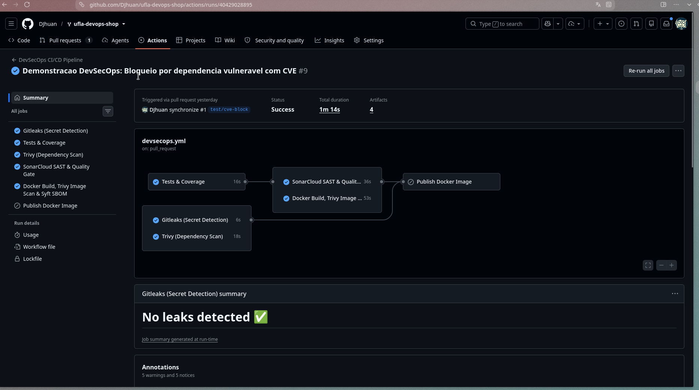
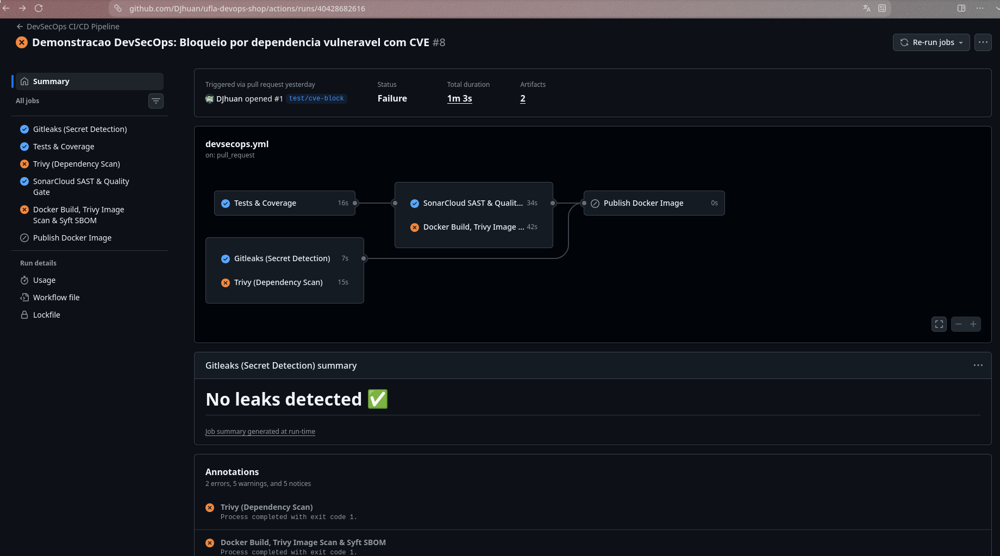
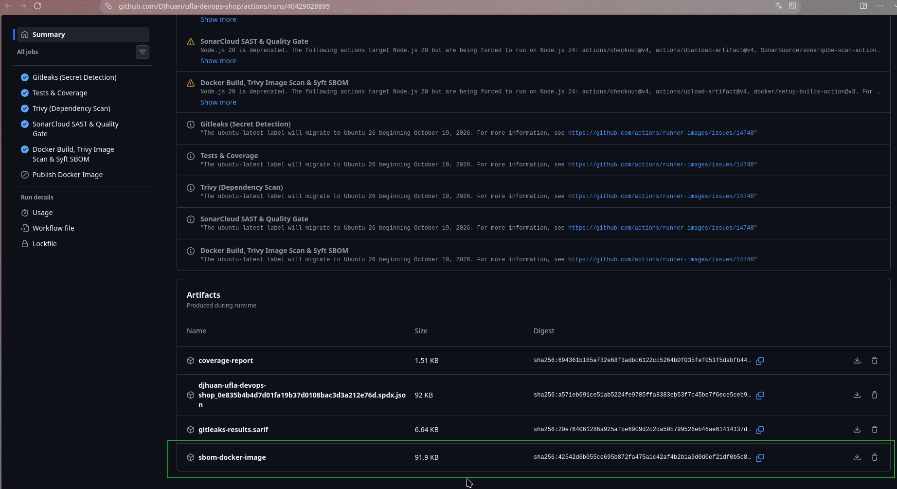

# Evidências de Funcionamento do Projeto

## Evidência de execução

Print da tela do pipeline executado:



[Link da execução](https://github.com/DJhuan/ufla-devops-shop/actions/runs/40429028895)
> Note que a última ação foi pulado. Isso ocorreu porque num commit anterior de teste, a imagem havia sido publicada e nesta execução ela não sofreu alteração.

## Captura de PR bloqueado



[Link da execução com erro](https://github.com/DJhuan/ufla-devops-shop/actions/runs/40428682616/job/121940762755)

Trecho:

```bash
  requirements.txt (pip)
  ======================
  Total: 8 (HIGH: 8, CRITICAL: 0)
  
  ┌─────────┬────────────────┬──────────┬────────┬───────────────────┬────────────────┬─────────────────────────────────────────────────────────────┐
  │ Library │ Vulnerability  │ Severity │ Status │ Installed Version │ Fixed Version  │                            Title                            │
  ├─────────┼────────────────┼──────────┼────────┼───────────────────┼────────────────┼─────────────────────────────────────────────────────────────┤
  │ urllib3 │ CVE-2021-33503 │ HIGH     │ fixed  │ 1.26.4            │ 1.26.5         │ python-urllib3: ReDoS in the parsing of authority part of   │
  │         │                │          │        │                   │                │ URL                                                         │
  │         │                │          │        │                   │                │ https://avd.aquasec.com/nvd/cve-2021-33503                  │
  │         ├────────────────┤          │        │                   ├────────────────┼─────────────────────────────────────────────────────────────┤
  │         │ CVE-2023-43804 │          │        │                   │ 2.0.6, 1.26.17 │ python-urllib3: Cookie request header isn't stripped during │
  │         │                │          │        │                   │                │ cross-origin redirects                                      │
  │         │                │          │        │                   │                │ https://avd.aquasec.com/nvd/cve-2023-43804                  │
  │         ├────────────────┤          │        │                   ├────────────────┼─────────────────────────────────────────────────────────────┤
  │         │ CVE-2025-66418 │          │        │                   │ 2.6.0          │ urllib3: urllib3: Unbounded decompression chain leads to    │
  │         │                │          │        │                   │                │ resource exhaustion                                         │
  │         │                │          │        │                   │                │ https://avd.aquasec.com/nvd/cve-2025-66418                  │
  │         ├────────────────┤          │        │                   │                ├─────────────────────────────────────────────────────────────┤
  │         │ CVE-2025-66471 │          │        │                   │                │ urllib3: urllib3 Streaming API improperly handles highly    │
  │         │                │          │        │                   │                │ compressed data                                             │
  │         │                │          │        │                   │                │ https://avd.aquasec.com/nvd/cve-2025-66471                  │
  │         ├────────────────┤          │        │                   ├────────────────┼─────────────────────────────────────────────────────────────┤
  │         │ CVE-2026-21441 │          │        │                   │ 2.6.3          │ urllib3: urllib3 vulnerable to decompression-bomb safeguard │
  │         │                │          │        │                   │                │ bypass when following HTTP redirects (streaming...          │
  │         │                │          │        │                   │                │ https://avd.aquasec.com/nvd/cve-2026-21441                  │
  │         ├────────────────┤          │        │                   ├────────────────┼─────────────────────────────────────────────────────────────┤
  │         │ CVE-2026-44431 │          │        │                   │ 2.7.0          │ urllib3: urllib3: Information disclosure via cross-origin   │
  │         │                │          │        │                   │                │ redirects forwarding sensitive headers                      │
  │         │                │          │        │                   │                │ https://avd.aquasec.com/nvd/cve-2026-44431                  │
  │         ├────────────────┤          │        │                   ├────────────────┼─────────────────────────────────────────────────────────────┤
  │         │ CVE-2026-97687 │          │        │                   │ 2.8.0          │ urllib3: urllib3: Traffic interception via HTTPS proxy TLS  │
  │         │                │          │        │                   │                │ configuration override                                      │
  │         │                │          │        │                   │                │ https://avd.aquasec.com/nvd/cve-2026-97687                  │
  │         ├────────────────┤          │        │                   │                ├─────────────────────────────────────────────────────────────┤
  │         │ CVE-2026-97689 │          │        │                   │                │ urllib3: urllib3: Denial of Service via unbounded memory    │
  │         │                │          │        │                   │                │ allocation in chunk parser...                               │
  │         │                │          │        │                   │                │ https://avd.aquasec.com/nvd/cve-2026-97689                  │
  └─────────┴────────────────┴──────────┴────────┴───────────────────┴────────────────┴─────────────────────────────────────────────────────────────┘
Error: Process completed with exit code 1.
```

## Correção


[Link da execução](https://github.com/DJhuan/ufla-devops-shop/actions/runs/40429028895)

## Arquivo do SBOM gerado


